# ambientCG: Leather materials

**22 assets from [ambientCG](https://ambientcg.com), dedicated to the public domain under [CC0](https://docs.ambientcg.com/license/).** Use them in any game, free or paid, and change them however you like; no credit is needed.

PBR materials as 1K and 2K JPG maps (colour, normal GL and DX, roughness, AO, displacement), one folder per resolution. 793.1 MB in all.

This is a copy kept by [zuujis-cc0](https://github.com/zuujis-cc0) so game makers can take single files from GitHub. It is not made by or affiliated with ambientCG: the originals, often in more formats and higher resolutions, are on [ambientcg.com](https://ambientcg.com). If they help you, consider [supporting ambientCG](https://www.patreon.com/ambientCG).

Every file is listed in [MANIFEST.tsv](MANIFEST.tsv) with its size and SHA-256. More free assets: [the Zuujis collection](https://github.com/zuujis-cc0/free-game-assets#readme).

| | | | |
| :-: | :-: | :-: | :-: |
| <a href="Leather029">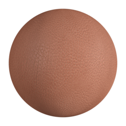</a> <b><a href="Leather029">Leather 029</a></b> by ambientCG · <a href="https://ambientcg.com/a/Leather029">source</a> | <a href="Leather030">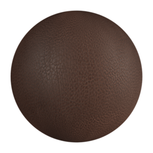</a> <b><a href="Leather030">Leather 030</a></b> by ambientCG · <a href="https://ambientcg.com/a/Leather030">source</a> | <a href="Leather031">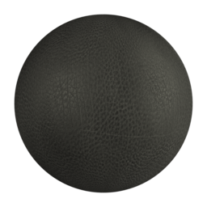</a> <b><a href="Leather031">Leather 031</a></b> by ambientCG · <a href="https://ambientcg.com/a/Leather031">source</a> | <a href="Leather032">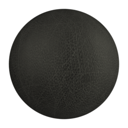</a> <b><a href="Leather032">Leather 032</a></b> by ambientCG · <a href="https://ambientcg.com/a/Leather032">source</a> |
| <a href="Leather033A">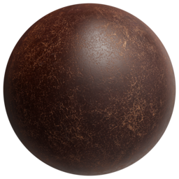</a> <b><a href="Leather033A">Leather 033 A</a></b> by ambientCG · <a href="https://ambientcg.com/a/Leather033A">source</a> | <a href="Leather033B">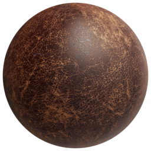</a> <b><a href="Leather033B">Leather 033 B</a></b> by ambientCG · <a href="https://ambientcg.com/a/Leather033B">source</a> | <a href="Leather033C">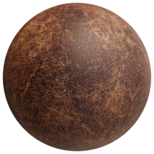</a> <b><a href="Leather033C">Leather 033 C</a></b> by ambientCG · <a href="https://ambientcg.com/a/Leather033C">source</a> | <a href="Leather034A">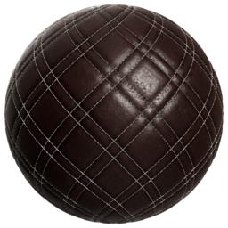</a> <b><a href="Leather034A">Leather 034 A</a></b> by ambientCG · <a href="https://ambientcg.com/a/Leather034A">source</a> |
| <a href="Leather034B">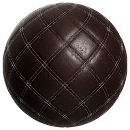</a> <b><a href="Leather034B">Leather 034 B</a></b> by ambientCG · <a href="https://ambientcg.com/a/Leather034B">source</a> | <a href="Leather034C">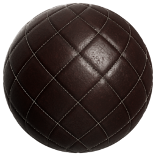</a> <b><a href="Leather034C">Leather 034 C</a></b> by ambientCG · <a href="https://ambientcg.com/a/Leather034C">source</a> | <a href="Leather034D">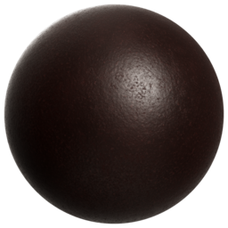</a> <b><a href="Leather034D">Leather 034 D</a></b> by ambientCG · <a href="https://ambientcg.com/a/Leather034D">source</a> | <a href="Leather035A">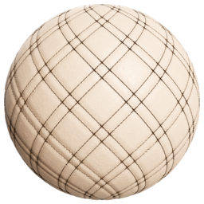</a> <b><a href="Leather035A">Leather 035 A</a></b> by ambientCG · <a href="https://ambientcg.com/a/Leather035A">source</a> |
| <a href="Leather035B">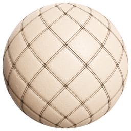</a> <b><a href="Leather035B">Leather 035 B</a></b> by ambientCG · <a href="https://ambientcg.com/a/Leather035B">source</a> | <a href="Leather035C">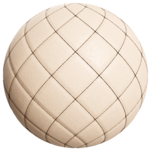</a> <b><a href="Leather035C">Leather 035 C</a></b> by ambientCG · <a href="https://ambientcg.com/a/Leather035C">source</a> | <a href="Leather035D">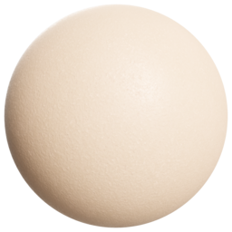</a> <b><a href="Leather035D">Leather 035 D</a></b> by ambientCG · <a href="https://ambientcg.com/a/Leather035D">source</a> | <a href="Leather036A">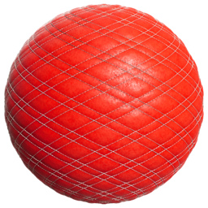</a> <b><a href="Leather036A">Leather 036 A</a></b> by ambientCG · <a href="https://ambientcg.com/a/Leather036A">source</a> |
| <a href="Leather036B">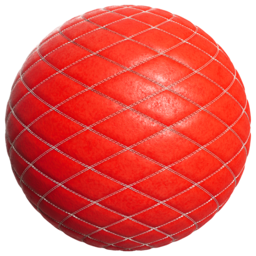</a> <b><a href="Leather036B">Leather 036 B</a></b> by ambientCG · <a href="https://ambientcg.com/a/Leather036B">source</a> | <a href="Leather036C">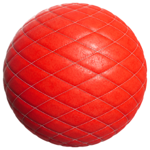</a> <b><a href="Leather036C">Leather 036 C</a></b> by ambientCG · <a href="https://ambientcg.com/a/Leather036C">source</a> |  <b><a href="Leather036D">Leather 036 D</a></b> by ambientCG · <a href="https://ambientcg.com/a/Leather036D">source</a> | <a href="Leather037">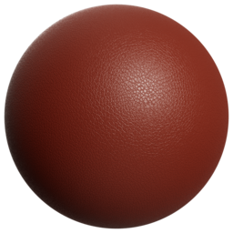</a> <b><a href="Leather037">Leather 037</a></b> by ambientCG · <a href="https://ambientcg.com/a/Leather037">source</a> |
| <a href="Leather038">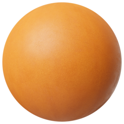</a> <b><a href="Leather038">Leather 038</a></b> by ambientCG · <a href="https://ambientcg.com/a/Leather038">source</a> | <a href="Leather039">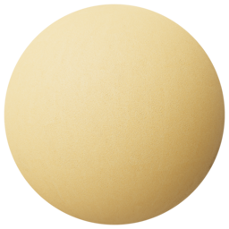</a> <b><a href="Leather039">Leather 039</a></b> by ambientCG · <a href="https://ambientcg.com/a/Leather039">source</a> |  |  |

---

Kept up to date by this repository's own [update workflow](.github/workflows/update.yml), with code and plan from [cc0-mirror](https://github.com/zuujis-cc0/cc0-mirror). Something wrong? [Open an issue there](https://github.com/zuujis-cc0/cc0-mirror/issues/new) or use the [private report form](https://games.zuujis.com/report).
